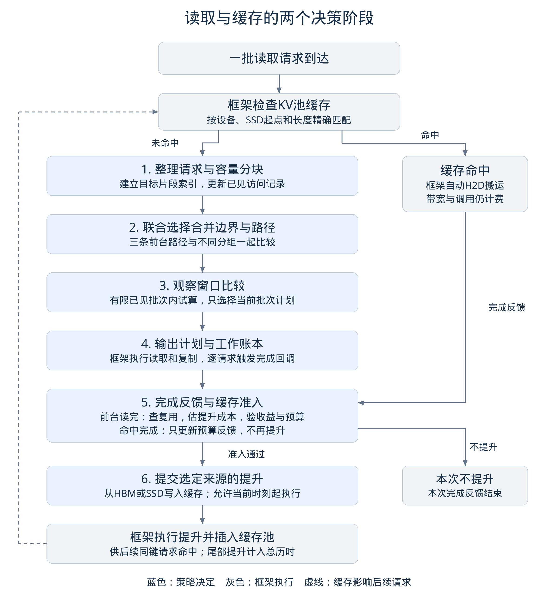

# 调度算法设计：怎样分组、选路与决定缓存

## 一、先看全貌：两次决策，围绕同一个总成本

**请求到达时，决定“哪些数据一起搬、走哪条路”；请求完成时，决定“是否再搬一份到缓存、从哪里搬”。** 前台负责本次读取，PROMOTE为后续复用付费。程序在线重复这两个决策，不提前读取未来请求。

一条Trace是一串按时刻到达的读取批次。每份请求IOCB给出SSD区间、目标卡和目标HBM片段（iov）。目标是正确完成全部请求，并最小化：

```text
J = c_t × T + C_CPU + C_NPU
```

c_t是每微秒成本，公开参数为1；T是整条Trace历时，包含尾部已提交PROMOTE；后两项是累计CPU、NPU调用费。**J由官方模拟器实际执行后计算；下文的局部估计只用于选方案，不是评分公式的替代品。** 费用和性能表来自固定官方SDK，详见[计费与术语](../00_快速入门/方案介绍.md)。

| 时点 | 框架做什么 | 我们做什么、输出什么 |
| --- | --- | --- |
| 一批请求到达 | 先查KVCache池；命中则自动安排H2D | `on_submit`只收到未命中请求，输出分组、路径、传输项和依赖 |
| 一份请求完整完成 | 触发完成回调 | `on_iocb_complete`返回一条PROMOTE，或不提升 |
| 传输执行与缓存插入 | 排队、共享带宽、释放缓冲；执行TTL与LRU | 读取可见状态，继续下一次决策 |

主流程如下。蓝色步骤由策略决定，灰色步骤由框架执行；不同请求的读取、提升和命中可以交错进行。



本文按“前台决策→完成后决策→数值例子→边界”展开。设计依据及baseline对照见[设计依据与优化评述](设计依据与优化评述.md)；实现上限与代码位置在文末。

## 二、前台：从一批未命中请求得到可执行计划

### 2.1 整理与分块：先保证每个片段都能合法搬运

先给每个IOCB的iov建立累计长度索引。例如两个目标片段长度为4KiB和2KiB，逻辑偏移5KiB对应第二个片段内偏移1KiB。切分后据此生成目标映射，保证只写本请求需要的数据。

默认以2MiB为块上限，从请求头依次切分。若片段不能DIRECT，还要保证向512B边界扩展后的物理范围能放进临时HBM或DDR中至少一个池；不够就缩小块，并把中间切点放在512B边界。普通规模输入还会另做一份8MiB块上限的计划。**2MiB/8MiB是上限，不是每次强制读取的长度。**

输出片段记录：所属IOCB、卡号、SSD起点和长度、目标映射、能否DIRECT、是否为完整IOCB。按“卡号、SSD起点、请求编号、片段偏移”排序，为下一步枚举分组做准备。

### 2.2 枚举分组：哪些片段允许放进同一操作

从排序后每个位置向后扩展，最多看128个片段。扩展中的一组记为G。以下条件全部满足，才继续考虑合并：

| 检查 | 具体规则 | 为什么需要 |
| --- | --- | --- |
| 同卡 | G中所有片段的device_id相同 | 一组传输只发往同一张卡 |
| SSD可连接 | 下个起点向下对齐512B后，不大于当前最远终点向上对齐512B后的值 | 允许相接、重叠及对齐边界内的小间隙，不跨任意大空洞 |
| 块大小 | 合并后的物理SSD范围不超过本次块上限 | 限制单组资源占用 |
| 拆分隔离 | 被拆分的IOCB不与其他IOCB共享操作 | 避免多个操作交叉占用请求槽位造成循环等待 |

对G同时计算两个长度：P是覆盖它的512B对齐物理范围长度；V是各目标有效长度之和。SSD按P读，复制按V搬。若请求重叠，P可能小于V；若需要对齐扩读，P也可能大于V。

随后检查三条路径。**合并不是AGGREGATE专属：三条路径都能服务多个当前请求，但合法条件不同。**

| 路径 | 数据路线 | 额外合法条件 |
| --- | --- | --- |
| DIRECT | SSD→目标HBM | 每个源/目标交集的地址、长度满足512B对齐；逻辑区间连续且不重叠；不同IOCB数不超槽位上限 |
| AGGREGATE | SSD→临时HBM→目标HBM | P不超临时HBM容量；不同IOCB数不超槽位上限 |
| FALLBACK | SSD→DDR→目标HBM | P不超DDR容量；此SDK不占NDS请求槽位 |

不合法的“分组＋路径”直接排除，其余交给成本比较。三条都不可用意味着输入资源下无法生成合法计划，程序报错，不输出缺少覆盖的方案。

### 2.3 估价与动态规划：同时决定分组边界和路径

每个合法候选的估计成本为：

```text
E(G, 路径) = c_t × (t_SSD + t_copy) × m + C_CPU + C_NPU
```

t_SSD、t_copy是按性能表计算的服务工作量，不包含完整队列等待。DIRECT没有复制，m=1；AGGREGATE/FALLBACK的m为“1＋0.5×对应临时池已用比例”，用于惩罚缓冲压力。公开参数下，一组恰有一读、至多一复制时：

| 路径 | t_SSD依据 | t_copy依据 | CPU＋NPU费 |
| --- | --- | --- | --- |
| DIRECT | P与NDS读取性能表 | 0 | 2＋0＝2 |
| AGGREGATE | P与NDS读取性能表 | V与D2D性能 | 4＋1＝5 |
| FALLBACK | P与DDR读取性能表 | V与H2D性能表 | 11＋1＝12 |

服务工作量按“字节数÷有效带宽”换算为微秒。SSD的并发估值取“当前活动SSD项＋本批片段数”；复制取“该卡同类活动项＋本批该卡IOCB数”，再受对应复制并发上限限制。大小、并发都按官方表向下选桶；D2D小块使用SDK对应的分段带宽公式。该并发估值是快速近似，合并后实际活动项可能减少，因此还需要2.4节的试算。

动态规划令dp[j]表示“前j个片段的最低累计估价”。枚举从i开始到j之前的合法分组及路径，更新：

```text
dp[0] = 0，其余为无穷大
对每个起点 i：
    对每个合法终点 j 和路径 p：
        若 dp[i] + E([i,j), p) 更小：
            更新 dp[j]，记录前驱 i 和路径 p
从最后一个片段向前回溯，得到整批分组与路径
```

例如有A、B、C三个片段，就比较“A/B/C”“AB/C”“A/BC”“ABC”及各组合法路径。动态规划保留最低累计估价的组合，避免先强行合并再被迫选路。它只在本批已见片段中规划，不是预测下一批请求。

### 2.4 试算少量完整计划：纠正合并与资源竞争的影响

局部估价相加不能准确反映并发、池容量、槽位和流水。因此程序分两种规模作补充比较：

| 情况 | 比较什么 | 选择规则 |
| --- | --- | --- |
| 最多6个完整片段，系统保守空闲，无缓存且从未发起提升 | 在本实现允许的连续分组中枚举分组与合法路径，交给官方模拟器 | 选模拟J更低的计划；仅对此受限候选族精确 |
| 普通规模：≤1024个请求、≤2048个iov、初始操作≤2048 | 2MiB和8MiB两种块上限，各比较原路径、偏AGGREGATE、偏FALLBACK，共至多6种组合 | 在有限已见批次窗口中试算，严格更低才替换 |
| 超出普通规模门槛 | 保留2MiB区间规划结果 | 控制决策开销 |

“偏某路径”只改写非DIRECT组，且必须放得进目标池、满足槽位条件；不合条件的组保留原路径。历史窗口从最近仍有未完成请求的批次中选取，最多32批，并受iov和操作预算裁剪。

**窗口重建不是实时系统快照。** 它省略窗口外工作、命中搬运和PROMOTE；比较路径偏好时可能反事实改写历史计划，但真实执行中只提交本次选中的计划，已经提交的旧操作不变。窗口J只用于候选排序，最终成绩必须看完整Trace官方回放。

### 2.5 提交与记账：把计划落实为传输依赖

每组生成一个operation。DIRECT输出一条SSD传输；AGGREGATE/FALLBACK输出一条SSD传输和一条多目标复制，后者的depends_on指向前者。有效数据通过ranges和vectors映射回原IOCB，不会因合并丢失请求边界。

前台priority=100，最早启动时刻为当前时刻，next_wakeup_us为空。真正何时启动由框架按依赖与资源安排。合并改变传输项数量；并发是某资源上已启动且尚未完成的传输项数量，两者不能混用。

最后仅为**最终选中计划**记账：组内SSD工作、复制工作和调用费按各IOCB有效字节占比分摊，保存到该请求的Work。后台据此估计“缓存命中能替代多少成本”，不拿baseline的高成本冒充本方案的节省。

## 三、完成后：按四道判断决定是否PROMOTE

PROMOTE是可选缓存投入，不是本次读取的收尾步骤。当前IOCB已经完成，才进入本节；若准入失败，直接返回“不提升”，本次读取仍然成功。

### 3.1 去重与复用：对象是否值得继续评估

缓存键为“卡号、SSD起点、完整长度”，不包含HBM地址。每个键维护访问间隔、最近需求、预算和提升状态。按以下顺序排除不合适对象：

| 判断 | 具体规则 |
| --- | --- |
| 是否由缓存命中完成 | 没有策略持有的前台Work记录就是命中；只给以后再准入积累预算，本次不PROMOTE |
| 是否重复投入 | 同键仍在提升，或已经提升且此后没有新的真实未命中证据，则不提升 |
| 是否有跨时刻重复 | 至少两次访问且正访问间隔已建立；同一时刻的重复不形成新的周期证据 |
| 是否能存活 | 对象≤池容量，平均间隔< TTL，最近需求年龄< TTL |
| 证据是否新鲜 | 需求年龄≤max(1微秒，平均间隔＋2×间隔抖动)，复用字节距离≤池容量 |

平均间隔按“旧值×0.5＋新间隔×0.5”更新；抖动按“旧值×0.5＋新间隔偏离旧平均的绝对值×0.5”更新。需求年龄从该键最近一次可见未命中到当前完成时刻计算，防止请求排队很久后仍按旧热点提升。

复用字节距离是“该键上次出现后，其他已证明重复的对象累计推进了多少字节”的近似压力指标；单次扫描不推进，重复对象可能重复计入。距离超池容量或两次未命中间隔达到TTL时，清除原复用计数和预算，重新收集证据。

去重无需逐次扫描全部驻留项：索引在途PROMOTE；结束后保持已准入标记。只有**提升已结束之后，框架又把同键作为未命中交给on_submit**，才解除保护。提升期间到达的旧未命中不能触发重复投入。实际命中与失效仍由框架判定。

### 3.2 比较来源：这次提升预计花多少成本

先比较PROMOTE_SSD与PROMOTE_HBM的预计就绪成本：SSD看全局读取负载；HBM看源卡D2H活动、在途提升数和并发上限。SSD代价严格更小时选SSD，否则选HBM；D2H并发上限为0时只能选SSD。

来源排序包含共享与排队影响；随后估算该来源的新增服务成本P，供预算判断。P包含PROMOTE固定费80，以及该来源的传输工作量与调用费。**排序用的排队等待不再次逐对象算进P**，避免为同一队列重复记账。精确公式见附录B。

### 3.3 算净收益：未来命中一次是否有用

先定义所需数据，所有时间量均为估值，单位微秒：

| 符号 | 从哪里来 |
| --- | --- |
| R、D | Work中分摊给该请求的SSD、前台复制工作量 |
| C | Work中分摊给该请求的CPU＋NPU调用费 |
| H | 本完整请求缓存命中后的H2D工作量估计 |
| a | 本批该卡有效字节数÷本批全部有效字节数，反映按卡复制的并行范围 |
| g | 提交本批时，最近两个可见on_submit的正到达间隔；未知时为0 |
| E | max（本批全局SSD工作之和＋最忙卡复制工作之和，本请求等待加执行时长） |

若g已知且E<g，节省的服务时间可能被空闲间隔吸收，时间权重w取0；否则w取1。单次命中的净收益估计为：

```text
G = w × c_t × [R + a × (D − H)] + C − C_hit
C_hit = 命中的CPU H2D费 + NPU H2D费 = 2（公开参数）
```

G≤0就不提升。例如稀疏DIRECT的C=2，w=0时G=0；稀疏FALLBACK若独占一组，C=12，仍有G=10的调用费收益。**空闲只折扣时间收益，不抹掉调用费节省。** 最近间隔并不保证未来；整批命中也不进入on_submit，因此这是近似预测。

### 3.4 查预算与容量：有收益，也不能无限投资

预算Q衡量已经观察到的读取支出。对尚未记账的不同到达时刻数m，用当前完成请求的工作估计增加：

```text
Q ← Q + m × max(0, c_t × [R + a × D] + C)
```

同一到达时刻不重复入账；第一轮虽因无复用不准入，第二轮可把此前未记账次数一起计入。它是按当前工作估计外推的历史支出预算，不是预测未来会命中m次。命中完成则增加上次估计的正收益，累计不超过上次提升成本P。

容量压力提高所需预算，但不禁止满池后的热点替换：

```text
门槛 A = P × (1 + max(0, U + F + s − K) / K)
准入条件：G > 0 且 Q ≥ A
```

K是KV池容量，U是框架报告的驻留字节，F是本策略已知在途提升字节，s是待提升完整对象大小。对象放不进整个池的情况已在3.1节排除；“超出容量的字节÷K”只是替换压力代理，不是精确计算被驱逐对象的损失。

通过后把Q清零，记录收益和已付成本，输出一条针对当前完整IOCB的PROMOTE：priority=10，not_before_us=当前时刻。这表示允许现在开始，不保证立刻启动，也不保证与前台互不干扰。

提升完成后才能命中；TTL从插入时开始，命中更新LRU但不续TTL。TTL到期**或**插入时容量不足都可能导致失效；容量不足时由框架按LRU逐个驱逐，我们不指定受害者。

## 四、把规则算一遍：何时合并，何时缓存

### 4.1 实际回放：相邻读取不一定应该合并

两个教学输入都只有一批、同卡三个请求、池容量充足，使用公开资源和费用。下表是官方模拟器执行与独立回放结果，输入、选中计划和候选详情保存在[示例目录](示例/)。它们用于解释决策，不并入481条冻结验证矩阵，也未用于调参。

| 输入与候选 | Trace时间T | CPU | NPU | J（c_t=1） |
| --- | --- | --- | --- | --- |
| 三个相邻512B、源目标均对齐：分别DIRECT | 4 | 6 | 0 | 10 |
| 同上：合并DIRECT，实际选中 | 4 | 2 | 0 | **6** |
| 三个相邻4KiB、目标地址不对齐：合并AGGREGATE | 93 | 4 | 1 | 98 |
| 同上：分别AGGREGATE，实际选中 | 33 | 12 | 3 | **48** |
| 同上：合并FALLBACK | 61 | 11 | 1 | 73 |
| 同上：分别FALLBACK | 61 | 33 | 3 | 97 |

第一个输入的三个SSD区间是[0,512)、[512,1024)、[1024,1536)。合并后只有一条1536B DIRECT传输，仍覆盖三份IOCB；时间相同，节省两组调用费，J从10降到6。没有跨时刻重复，完成后不PROMOTE。

第二个输入把长度改为4KiB、目标地址各加1，DIRECT不合法。合并AGGREGATE确实少付10单位调用费，却让一次12KiB D2D替代了三个并行的4KiB D2D：在该性能模型下，T由33增到93，反而多花50单位J。小批全枚举发现这一差异，保留三个独立AGGREGATE操作。

这也说明为何需要试算：本例局部估价用复制并发3，可能高估合并后单个复制的带宽；完整计划模拟会按实际活动项重算。**少操作只是手段，最终选择由时间和调用费共同决定。**

可直接复现：

```bash
python3 run.py solve --prebuilt --input 02_算法方案/示例/相邻对齐小读输入.json --result aligned.json
python3 run.py solve --prebuilt --input 02_算法方案/示例/相邻非对齐读取输入.json --result unaligned.json
```

### 4.2 算式示例：有收益，但预算不足时仍不提升

以下是代入公式的教学假设，不是上表实测值：对象已通过复用与新鲜度检查，R=30、D=10、H=12、C=12、a=1、c_t=1；本批E=200，最近提交间隔g=2000，因此w=0。来源比较后P=100。

一次命中的G=0×[30＋10−12]＋12−2=10，确有调用费收益。每次已观察读取提供预算30＋10＋12=52。设K=8MiB、U=7MiB、F=1MiB、s=1MiB，需替换1MiB，门槛A=100×(1＋1/8)=112.5。

| 当前证据 | 预算 | 判定 |
| --- | --- | --- |
| 首次出现 | 不做准入 | 没有跨时刻复用 |
| 第二次完成，把两次尚未记账的观察入账 | 2×52=104 | G虽为正，但104<112.5，不提升 |
| 第三次完成，且需求与工作估值仍相同 | 104＋52=156 | 156≥112.5，提升并把预算清零 |

满池并没有把对象永远挡在外面；更多新鲜复用证据可以支持替换。反过来，若w=0且C=2，则G=0，即使预算充足也不提升。若第三次后不再访问，刚发起的提升仍可能亏损——在线历史不能保证未来收益。

## 五、方案取舍与结论

本方案的三层分工是：**区间规划选分组与路径；有限试算检查这些操作一起运行的效果；完成反馈用复用、净收益和预算限制缓存投入。** 每层都给出具体候选和判断条件，最后统一回到整条Trace的J验证。

| 边界 | 处理方式或限制 |
| --- | --- |
| 对齐、容量、请求槽位与覆盖 | 规划时过滤，官方回放再检查；无法合法完成时明确报错 |
| 无复用、同刻重复、对象过大、TTL/新鲜度不满足 | 不PROMOTE；前台读取照常完成 |
| 满池、热点迁移 | 按替换压力提高预算，允许新热点进入；不精确估计LRU受害者价值 |
| 缓存命中、后台竞争 | 命中仍占H2D并收费；PROMOTE_SSD共享SSD；低优先级不等于资源隔离 |
| 到达突变、尾部提升 | 最近间隔与历史预算可能误判；尾部提升仍进入Trace时间 |
| 大输入与复杂状态 | 搜索有界、必要时跳过试算；窗口不含全部后台状态，不能保证全局最优 |

当前源码公开自动分89.9899/90；481条输入各三次运行和回放通过。220条扩展贪心对照中193条更优、1条持平、26条更差；当前源码冻结后新生成的24条组合中14条更优、10条更差，最大回退3.35%。这些是所测范围内的证据，不代表每例必胜、无过拟合证明或真实硬件加速。详见[验证报告](../05_验证结果/验证报告.md)与[边界条件](通用性与边界条件.md)。

## 附录A：实现预算与复杂度

以下数值控制搜索和状态规模，不是按测试编号匹配的特例。

| 项目 | 当前实现 |
| --- | --- |
| 前台块上限候选 | 2MiB、8MiB；实际受对齐与池容量约束 |
| 区间向后搜索窗口 | 最多128个片段 |
| 普通候选比较入口 | 当前请求数不超过1024、iov不超过2048、初始操作数不超过2048 |
| 历史观察窗口 | 最多32批；加入历史时总iov不超过32768、累计初始操作预算不超过512 |
| 成本结果复用 | 无历史前缀且操作形状一致时复用，最多64项，每项签名不超过32768个整数 |
| 微批枚举 | 保守空闲、无缓存或提升历史、最多6个完整块和256个iov；每次规划至多3072个候选，两个块上限可各触发一次 |
| 访问历史队列 | 最多131072条更新记录 |

微批枚举只在受限候选集合内精确。成本结果复用的是相同操作形状的局部试算，不是把不同实时队列的成本视为相同，也不读取用例标识。

设V为总iov数、B为片段数、W=128、L为最终目标映射交集数。索引构建为O(V)，排序为O(B log B)，区间候选最多O(BW)，所有者集合维护还包含对数因子，映射约为O(B log Vmax + L)。局部模拟耗时另取决于事件和活动传输数，不能把整个策略简写为O(BW)。

观察窗口和历史记录有界，但SDK输入输出、在途请求和缓存状态仍占内存；本方案不声称恒定内存或任意规模安全。

缓存准入不再按驻留条目数C逐次扫描；同步R个在途提升使用集合和映射，约为O(R log(R+1))，还需读取活动传输。框架自身的TTL清理仍遍历缓存，不能因此声称整个模拟器消除了与C相关的开销。

## 附录B：来源估价与代码对应

为避免正文被符号打断，PROMOTE来源估价集中列在这里。令f_S为按物理长度和DDR读取性能表得到的SSD服务微秒，f_H为按完整有效长度和复制性能表得到的D2H服务微秒；q_S=全局活动SSD项＋1，至少1；q_H=源卡活动D2H项＋1，受D2H上限L限制，至少1。两项服务估值都使用各自q查桶。n_S、n_H分别是在途SSD提升数、源卡HBM提升数。

```text
SSD来源排序值 = c_t × f_S × q_S × (1 + n_S/q_S) + CPU_PROMOTE_PER_CMD_COST
HBM来源排序值 = c_t × f_H × q_H × (1 + n_H/max(1,L))
                + CPU_D2H_CALL_COST + NPU_D2H_CALL_COST
```

两边共同的固定费80不影响来源排序。选定后，新增投入P按下式计算；a仍为本批源卡字节占比：

```text
选SSD：P = CPU_PROMOTE_FIXED_COST + c_t × f_S + CPU_PROMOTE_PER_CMD_COST
选HBM：P = CPU_PROMOTE_FIXED_COST + c_t × f_H × a
          + CPU_D2H_CALL_COST + NPU_D2H_CALL_COST
```

乘并发数和在途比例是就绪时间代理；P中的a是按卡并行范围的近似权重，都不是官方直接收取的费用。官方只按实际传输执行和固定费率算J。

唯一策略文件为[solution.cpp](../03_程序/player/solution.cpp)。阅读时按下表定位即可：

| 文中步骤 | 函数或变量 |
| --- | --- |
| 目标映射与DIRECT检查 | `IovIndex`、`direct_ok` |
| 分块、候选区间、动态规划和小批枚举 | `on_submit`中的`build_decision` |
| 分组路径估价 | `estimate` |
| 有限窗口试算 | `recent_`、`rewrite_path`、`evaluate` |
| 输出传输依赖 | `operation` |
| 为完成请求记录R、D、C等 | `work_`，只记录最终选中计划 |
| 同键重复提升保护 | `sync_promotions`、`pending_keys_`、`cache_admitted` |
| 复用、来源、收益、预算、准入 | `on_iocb_complete` |
