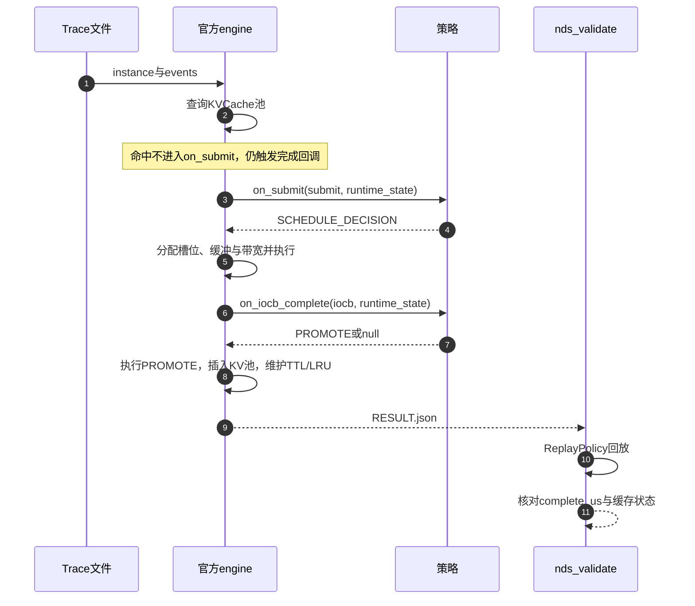

# 输入输出格式说明

本文描述提交程序与官方SDK之间的文件格式和回调协议。字段定义以仓库`public/include/nds/framework.hpp`、`public/src/framework.cpp`为准；策略只实现`01_调度算法源代码/player/solution.cpp`。

## 一、回调协议

策略接口：

```cpp
create_policy(resources, fixed_parameters)       // 读取固定资源与费率
on_submit(submit, runtime_state)  -> Json        // 返回SCHEDULE_DECISION
on_iocb_complete(iocb, runtime_state) -> optional<Json>  // 返回PROMOTE或空
```

一次Trace的回调与校验顺序：



## 二、输入Trace

### 2.1 文件结构

```json
{
  "instance": {
    "instance_id": "case-name",
    "resources": { "...": 0 },
    "runtime_limits": { "...": 0 },
    "fixed_parameters": { "...": 0 }
  },
  "events": [
    {
      "event": "IO_SUBMIT",
      "time_us": 0,
      "submit": {
        "submit_id": 1,
        "arrival_us": 0,
        "iocbs": [
          {
            "iocb_id": 1,
            "opcode": "READV",
            "device_id": 0,
            "ssd_offset": 1048576,
            "length": 4680,
            "iovs": [
              {"iov_id": 0, "hbm_addr": 68719476736, "length": 4096},
              {"iov_id": 1, "hbm_addr": 68719480833, "length": 584}
            ]
          }
        ]
      }
    }
  ]
}
```

### 2.2 字段

| 层级 | 字段 | 必填 | 约束 |
| --- | --- | --- | --- |
| `instance` | `instance_id` | 否 | 缺省为`nds-instance` |
| `instance.resources` | 12项，见2.3 | 是 | 非负整数 |
| `instance.runtime_limits` | 对象内4项，见2.3 | 对象必填，字段可省略 | 非负整数 |
| `instance.fixed_parameters` | 14项，见2.3 | 是 | 整数 |
| `events[]` | `event` | 是 | 固定`IO_SUBMIT` |
| `events[]` | `time_us` | 是 | 非负，按时间非降序 |
| `submit` | `submit_id` | 是 | 全Trace唯一 |
| `submit` | `arrival_us` | 否 | 必须等于`time_us` |
| `submit.iocbs[]` | 数量 | 是 | 1～1024 |
| `iocb` | `iocb_id` | 是 | 同一submit内唯一 |
| `iocb` | `opcode` | 是 | 固定`READV` |
| `iocb` | `device_id` | 是 | NPU卡号 |
| `iocb` | `ssd_offset` | 是 | 非负，区间不溢出 |
| `iocb` | `length` | 是 | 正整数，等于所有iov长度之和 |
| `iov` | `iov_id` | 是 | 同一iocb内唯一 |
| `iov` | `hbm_addr` | 是 | 目标HBM虚拟地址 |
| `iov` | `length` | 是 | 正整数 |

第`k`个iov对应SSD区间`[ssd_offset+Σ_{j<k}length_j, +length_k)`。所有地址、长度、编号与时刻使用SDK的有符号64位整数范围，并须满足溢出检查。

### 2.3 固定字段

资源12项：

```text
nvme_bw  iocb_capacity  hbm_capacity  ddr_capacity  cpu_copy_bw
h2d_bw  d2h_bw  d2d_bw
hbm_copy_concurrency  h2d_copy_concurrency  d2h_copy_concurrency
kvcache_pool_capacity
```

`hbm_capacity`、`ddr_capacity`、`kvcache_pool_capacity`单位为MiB；`nvme_bw`、`cpu_copy_bw`、`h2d_bw`、`d2h_bw`、`d2d_bw`单位为MiB/s；其余按字段语义。`mooncake_capacity`可作为`kvcache_pool_capacity`的别名，二者同时出现时必须相等。

费率14项：

```text
promote_ttl_us  time_cost_per_us
CPU_NDS_FIXED_COST  CPU_NDS_PER_CMD_COST
CPU_PROMOTE_FIXED_COST  CPU_PROMOTE_PER_CMD_COST
CPU_FALLBACK_FIXED_COST  CPU_FALLBACK_PER_CMD_COST
CPU_H2D_CALL_COST  CPU_D2H_CALL_COST  CPU_D2D_CALL_COST
NPU_H2D_CALL_COST  NPU_D2H_CALL_COST  NPU_D2D_CALL_COST
```

`promote_ttl_us`以微秒计，其余为模型成本单位。运行限制4项：`max_cpus`、`max_processes`、`max_memory_mb`、`decision_timeout_ms`。

### 2.4 回调中的运行时状态

`runtime_state`不写在Trace文件中，由engine在每次回调时传入：

| 字段 | 含义 |
| --- | --- |
| `current_time_us` | 当前模拟时刻 |
| `foreground_iocb_inflight` | 已占用的前台IOCB槽位 |
| `transfers_inflight[]` | 在飞传输：`transfer_id`、`group_id`、`type`、`device_id`、`size`、`start_us`、`remaining_bytes` |
| `aggregate_hbm_used` / `fallback_ddr_used` | 临时HBM、DDR当前占用字节 |
| `kvcache_pool_used` | KV池占用字节 |
| `cached_ranges[]` | 当前缓存键`[device_id, ssd_offset, length]` |
| `promote_inflight[]` | 在飞提升：`promote_id`、`path`、`source_submit_id`、`source_iocb_id` |
| `queued_iocbs[]` | 已提交但未获得槽位的IOCB |

## 三、策略输出

### 3.1 前台决策

```json
{
  "event": "SCHEDULE_DECISION",
  "submit_id": 1,
  "operations": [
    {
      "operation_id": 1,
      "path": "FALLBACK",
      "ranges": [
        {"iocb_id": 1, "iocb_offset": 0, "length": 4680}
      ],
      "buffer_bytes": 5120,
      "transfers": [
        {
          "transfer_id": 1,
          "type": "SSD_TO_DDR",
          "device_id": 0,
          "physical_ssd_offset": 1048576,
          "physical_length": 5120,
          "group_id": 1,
          "not_before_us": 0,
          "depends_on": [],
          "priority": 100
        },
        {
          "transfer_id": 2,
          "type": "H2D",
          "device_id": 0,
          "bytes": 4680,
          "vectors": [
            {"iocb_id": 1, "iov_id": 0, "iov_offset": 0, "length": 4096},
            {"iocb_id": 1, "iov_id": 1, "iov_offset": 0, "length": 584}
          ],
          "group_id": 1,
          "not_before_us": 0,
          "depends_on": [1],
          "priority": 100
        }
      ]
    }
  ],
  "next_wakeup_us": null
}
```

| 路径 | `transfers`必须包含 | 复制依赖 | 附加字段 |
| --- | --- | --- | --- |
| `DIRECT` | `DIRECT` | 无 | 无 |
| `AGGREGATE` | `SSD_TO_HBM_BUFFER`、`D2D` | D2D依赖SSD阶段 | `buffer_bytes≤hbm_capacity×2²⁰` |
| `FALLBACK` | `SSD_TO_DDR`、`H2D` | H2D依赖SSD阶段 | `buffer_bytes≤ddr_capacity×2²⁰` |

字段约束：

| 字段 | 约束 |
| --- | --- |
| `operation_id` | 同一submit内唯一 |
| `transfer_id` | 全Trace内唯一；前台与PROMOTE共用编号空间 |
| `ranges` | 全部未命中IOCB的`[0,length)`恰好覆盖一次，不重不漏 |
| `path` | 仅`DIRECT`、`AGGREGATE`、`FALLBACK` |
| `physical_ssd_offset`、`physical_length` | 512B对齐 |
| `vectors` | 每条`iocb_id/iov_id/iov_offset/length`必须落在iov内，且完整覆盖该operation的逻辑交集 |
| `bytes` | 若与`vectors`同时出现，必须等于向量长度之和 |
| `depends_on` | 只能引用本决策内已存在的`transfer_id`，依赖图无环 |
| `buffer_bytes` | 非DIRECT必填；不小于SSD阶段物理字节；不超过对应池容量 |

`group_id`只表示批量组织，不形成资源独占；`priority`仅在竞争硬资源时使用；`not_before_us`为最早启动时间；`next_wakeup_us`可为`null`。

### 3.2 PROMOTE决策

`on_iocb_complete`返回空表示不提升，否则返回一条：

```json
{
  "promote_id": 10,
  "not_before_us": 138,
  "source_submit_id": 1,
  "source_iocb_id": 1,
  "path": "PROMOTE_HBM",
  "transfer": {
    "transfer_id": 20,
    "device_id": 0,
    "type": "D2H",
    "bytes": 4680,
    "vectors": 2,
    "priority": 10
  }
}
```

| 路径 | `type` | 必须覆盖 |
| --- | --- | --- |
| `PROMOTE_SSD` | `SSD_TO_MOONCAKE` | `physical_span(ssd_offset, length)`的完整对齐范围 |
| `PROMOTE_HBM` | `D2H` | `bytes`等于源IOCB的`length` |

源IOCB必须已完整完成；`promote_id`全Trace唯一；`transfer_id`不得与已有传输重复。`PROMOTE_HBM`示例中的`vectors: 2`表示源IOCB的iov个数，实际计量以`bytes`为准。PROMOTE不阻塞源IOCB的完成。

### 3.3 结果文件

```json
{
  "schedule_decisions": [ ... ],
  "promotion_decisions": [ ... ],
  "events": [ ... ],
  "metrics": { ... }
}
```

`schedule_decisions`、`promotion_decisions`原样保存策略回调的返回值。`events`由engine生成：

| 事件 | 触发 | 主要字段 |
| --- | --- | --- |
| `PROMOTE_START` | PROMOTE实际取得资源 | `time_us`、`promote_id`、源IOCB、`path` |
| `IOCB_COMPLETE` | 前台IOCB全部阶段完成 | `time_us`、`completions[]`中的`submit_id`、`iocb_id`、`complete_us` |
| `PROMOTE_COMPLETE` | PROMOTE传输完成 | `time_us`、`completions[]`中的`promote_id`、`complete_us`、`cached` |

`metrics`字段：

| 字段 | 含义 |
| --- | --- |
| `trace_time_us` | Trace历时`T` |
| `valid_bytes` / `physical_ssd_bytes` | 有效字节、物理SSD读取字节 |
| `read_amplification` | 物理读取÷有效字节 |
| `effective_bandwidth_mb_s` | 有效带宽 |
| `cpu_cost` / `npu_cost` / `total_cost` | 累计成本与`J` |
| `cache_hits` | KV池命中次数 |
| `promote_count` / `promote_success` / `promote_hit_rate` | 提升次数、成功入池次数、成功入池率 |
| `evictions` | 驱逐次数 |
| `latency_p50_us` / `latency_p95_us` / `latency_p99_us` | IOCB时延分位数 |

`total_cost = time_cost_per_us × trace_time_us + cpu_cost + npu_cost`。`trace_time_us`包含尾部已提交提升；`promote_hit_rate`表示成功入缓存次数÷提升次数，不是后续复用命中率。

## 四、合法性检查

校验器用`ReplayPolicy`重新执行结果中的计划，并核对引擎复算的完成事件，检查：

1. 每个未命中IOCB有效范围恰好覆盖一次；
2. DIRECT三项512B对齐；所有SSD物理范围512B对齐；
3. 路径与传输阶段匹配，复制完整覆盖逻辑iov，AGGREGATE物理范围连续；
4. operation不跨卡，依赖无环，ID唯一；
5. `buffer_bytes`不超过HBM/DDR池容量；
6. PROMOTE只引用已完成IOCB，覆盖完整有效范围；
7. 完成时刻与评测器复算一致，缓存、TTL与LRU状态一致。

任一检查失败，该Trace不可行。策略在规划阶段即过滤不合法候选；无法生成合法计划时明确报错，不输出缺少覆盖的结果。详细规则和固定版本见[材料来源](../05_自动化测试与复现/依赖来源/材料来源.md)。
