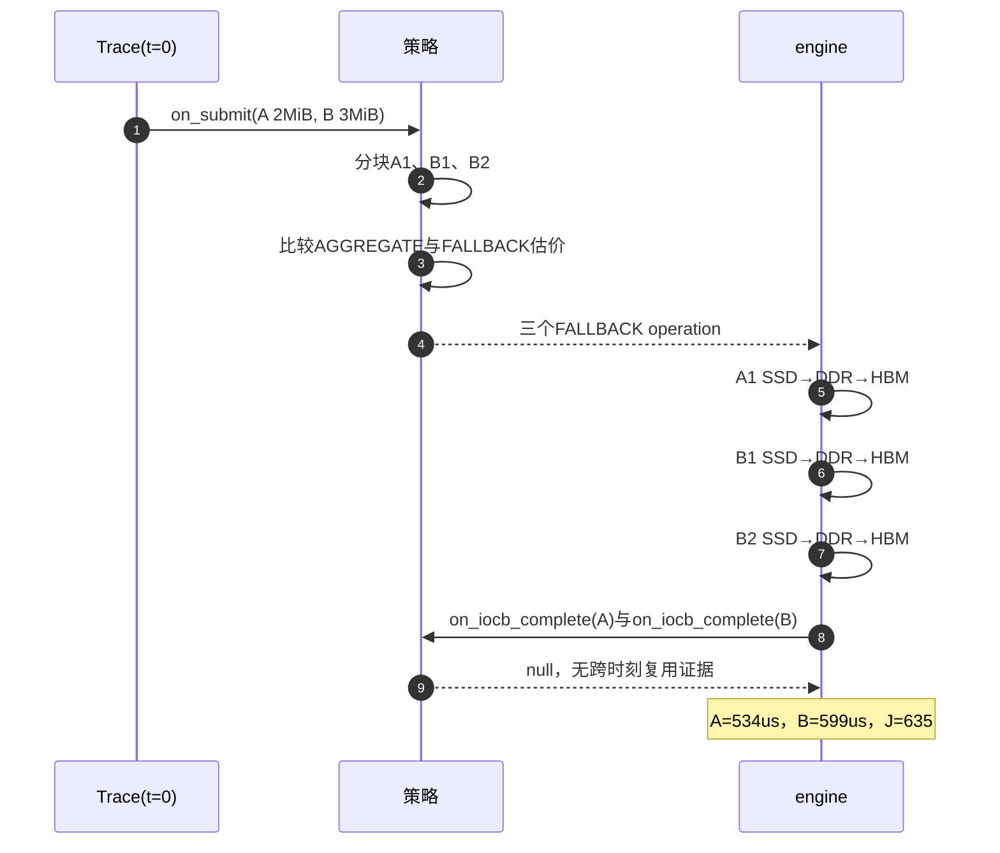

# 从SSD偏移100B读5MiB，分给A、B两张卡

本例明确采用：**A接收前2MiB，B接收后3MiB，目标地址都512B对齐**。1MiB=1,048,576B；题目输入已经指定目标卡，调度器无权自行把A的数据分配给B。

## 1. 输入先规定要什么

只有t=0的一批、两个IOCB，无初始缓存：

| 请求 | 卡 | SSD逻辑范围（左闭右开） | 长度 | 目标HBM起点 |
| --- | --- | --- | --- | --- |
| A | 0 | [100, 2,097,252) | 2MiB | 68,719,476,736 |
| B | 1 | [2,097,252, 5,242,980) | 3MiB | 137,438,953,472 |

资源沿用公开输入：临时HBM256MiB、DDR1024MiB、1024个NDS槽位等。完整配置见[输入JSON](示例/双卡分配输入.json)。这是教学输入，不计入评分集。

## 2. 先判断合法性

两个SSD起点模512均为100，DIRECT不合法。AGGREGATE和FALLBACK支持非对齐逻辑数据，但SSD物理命令仍需512B对齐。

例如A需要[100,2,097,252)，可以物理读[0,2,097,664)，再只复制其中需要的2MiB。前面多读100B、末尾多读412B；不能从512开始，否则会漏掉数据。

A和B属于不同卡，不合并成同一组。两种临时池都能放下完整请求，因此本例分块并非容量强制要求。**512B物理对齐是题目限制；2MiB块上限是当前算法的人为参数。**

## 3. 按统一规则分块，再估价选路

A长度恰为2MiB，保留整块。B长3MiB，先按2MiB上限截取；因为后面还有数据，将第一块末端退到512B边界，避免两块重复读取边界扇区。因此B分为2MiB−100B和1MiB＋100B。

| 块 | 交付给谁 | 请求内偏移 | 有效长度 | 物理SSD范围 |
| --- | --- | ---: | ---: | --- |
| A1 | A的目标HBM | 0 | 2MiB | [0,2,097,664) |
| B1 | B的目标HBM | 0 | 2MiB−100B | [2,097,152,4,194,304) |
| B2 | B的目标HBM | 2MiB−100B | 1MiB＋100B | [4,194,304,5,243,392) |

每块保留原请求的目标映射；B2目标地址也必须向后移动2MiB−100B，不能把对齐扩读的额外字节交给用户。

接着，程序按公开带宽表和调用费估计AGGREGATE与FALLBACK的工作量。三块都能放入两种池；该配置下FALLBACK的复制性能优势抵消了较高调用费，估值选择三个FALLBACK。A与B不能跨卡合并，B两块合并后的物理范围超过当前2MiB合组上限，因此本例的细化搜索没有把它们重新合成一块。

## 4. 提交后由框架执行

[实际输出](示例/双卡分配输出.json)有三个FALLBACK操作，每个含一条SSD→DDR和一条DDR→目标HBM。每条H2D只依赖本块SSD读取，不强加“先做A再做B”。前台优先级100，允许t=0开始；实际排队和带宽分摊由外层engine执行。



有效交付共5,242,880B，物理读5,243,904B，多读1,024B。每个FALLBACK的CPU费=8＋2＋1=11，NPU费=1，总CPU=33、NPU=3。

程序外的官方回放测得：A在534微秒完成，B在599微秒完成，整条Trace的J=599＋33＋3=635。

## 5. 为什么没有PROMOTE

每个键只在一个时刻出现，没有跨时刻复用证据，不满足缓存准入条件。完成回调返回“不提升”，两份请求均已成功完成。

在材料根目录复现：

```bash
python3 run.py solve --prebuilt --input 04_算法设计与复杂度/示例/双卡分配输入.json --result result.json
```
