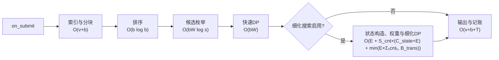

# 复杂度分析

本文分别给出前台（`on_submit`）与后台（`on_iocb_complete`）的时间、空间复杂度，以及跨Trace的状态开销。算法规则见[算法设计](算法设计.md)。

单次前台决策的耗时构成：



## 结论

| 范围 | 时间复杂度 | 空间复杂度 |
| --- | --- | --- |
| 前台单次`on_submit` | `O(v + b log b + bW log s + E + S_cnt×(C_state+E) + min(E×Σₛcntₛ, B_trans))` | `O(v + b + E + C_state)` |
| 后台单次`on_iocb_complete` | `O(T + R(log R + log H) + log H)` | `O(T + R)`临时，`O(H + R)`持久 |
| 整条Trace | `Σ_on_submit T_fg + Σ_complete T_bg` | `O(H + 在飞IOCB + R)`（持久） |

`E`、`C_state`、`B_trans`、`H`均有固定上限，见下节。单次决策只取决于本次提交的`s、v、b`，不随Trace已处理长度增长；细化搜索另有固定预算。

## 一、符号与固定上限

| 符号 | 含义 | 规模 |
| --- | --- | --- |
| `s` | 单次提交的IOCB数 | ≤1024 |
| `v` | 单次提交的iov总数 | 细化搜索要求≤2048 |
| `b` | 分块后的片段数 | 细化搜索要求≤16384；快速路径不受此限 |
| `W` | 候选枚举窗口 | 128 |
| `E` | 存储的合法候选边数 | ≤262144 |
| `S_cnt` | 细化DP的组数采样数 | ≤81 |
| `Σₛcntₛ` | 全部采样`cnt`之和，已含`S_cnt`次采样 | ≤`S_cnt×b` |
| `C_state` | 单个`cnt`的DP状态上限 | 131072 |
| `B_trans` | 每次`on_submit`的转移预算 | 2000000 |
| `H` | 访问历史记录上限 | 131072 |
| `T` | 在飞传输项数 | 运行时状态给出 |
| `R` | 在飞PROMOTE数 | 运行时状态给出 |

性能桶只有7个尺寸档，桶查找为`O(1)`；所有估价为常数次算术运算。

## 二、前台 `on_submit`

### 2.1 时间

| 步骤 | 复杂度 | 说明 |
| --- | --- | --- |
| 建立iov索引与历史登记 | `O(v + s log H)` | 每个IOCB一次`map`操作 |
| 分块 | `O(v + b)` | 每块只检查其相交的iov，整个IOCB的相交次数为`O(v+b)` |
| 排序 | `O(b log b)` | 按卡号、SSD起点、IOCB、偏移 |
| 候选枚举 | `O(bW log s)` | 最多`bW`个区间，每个3条路径；所有者集合插入为`O(log s)` |
| 快速区间DP | `O(bW)` | 每条候选边常数次估价 |
| 可达性前后缀 | `O(E + b)` | 仅在细化搜索启用时执行 |
| 细化状态构造 | `O(S_cnt × C_state)` | 每个采样`cnt`分配至多`C_state`个`(h,i)`状态 |
| 候选权重预计算 | `O(S_cnt × E)` | 每个`cnt`都要对所有合法边重算与`cnt`相关的估价 |
| 细化DP转移 | 未截断`O(E×Σₛcntₛ)`；实际`O(min(E×Σₛcntₛ, B_trans))` | 第`h`层扫`Σ_{i∈R_h}|edges[i]|≤E`条边；单次采样`cnt`层、共`O(cnt×E)`；预检超预算则放弃该`cnt` |
| 输出与记账 | `O(v + b + T)` | 生成ranges/vectors并分摊工作 |

合并为：

```text
T_fg = O(v + b log b + bW log s + E + S_cnt×(C_state+E) + min(E×Σₛcntₛ, B_trans))
```

每个采样`cnt`先构造至多`C_state`个状态，再对全部`E`条合法边重算权重，这两项合计`S_cnt×(C_state+E)`。

细化转移对应四层循环：采样`cnt`、层`h`、状态`i`、出边`j`。第三、四层的单层代价为

```text
C_h = Σ_{i∈R_h} |edges[i]| ≤ Σ_i |edges[i]| = E
```

所以单个采样为`Σ_h C_h ≤ cnt×E`，全部采样为`E×Σₛcntₛ`。这里`E`只是**单层**上界，不是整个DP只扫一次；`Σₛ`已经包含`S_cnt`次采样。若每个采样统一记作`cnt`，总代价为`S_cnt×E×cnt`，又因`cnt≤b`，保守上界为`S_cnt×E×b`。代码在转移前预检各层出边数，超过剩余`B_trans`就放弃该`cnt`，所以实际转移总量为`O(min(E×Σₛcntₛ, B_trans))`。

`edges[i]`保存所有以片段`i`为起点、终点为`j+1`的合法候选，同一区间最多可有3条路径；`E=Σ_i|edges[i]|`。快速DP构建时对每个`i`向后枚举`j`并填充该表，细化DP直接复用，不重新枚举全局`j`。候选边超过262144条时直接关闭细化搜索，只保留快速DP。

### 2.2 空间

| 结构 | 空间 |
| --- | --- |
| 片段、iov索引、快速DP | `O(v + b)` |
| 候选边 | `O(E)` |
| 细化DP行 | `O(C_state)` |
| 候选权重 | `O(E)` |
| 输出JSON | `O(v + b)` |

每次提交的峰值空间为`O(v + b + E + C_state)`，与`cnt`无关；细化DP逐行复用，不保存全部`cnt`的表。

### 2.3 典型规模

公开与扩展用例中单个IOCB不超过8MiB、块上限2MiB，一个IOCB通常切为不超过5块，故`b=O(s)`，实际为数百至数千。此时主要开销是`O(bW)`的候选枚举与快速DP；细化搜索仅在系统空闲时执行，且受总预算限制。

## 三、后台 `on_iocb_complete`

| 步骤 | 复杂度 | 说明 |
| --- | --- | --- |
| 同步在飞PROMOTE | `O(R(log R + log H))` | 用`set`核对存活ID，再删除已完成项并更新历史标记 |
| 扫描运行时状态 | `O(T + R)` | 只遍历在飞传输与在飞提升 |
| 查询历史与工作记录 | `O(log H)` | 每个完成IOCB一次 |
| 来源估价、收益、预算 | `O(1)` | 常数次桶查找与算术 |
| 输出一条PROMOTE | `O(1)` | 单条传输 |

```text
T_bg = O(T + R(log R + log H) + log H)
```

后台**不遍历**全部缓存条目、`cached_ranges`或历史表；TTL、LRU和实际命中由框架维护。临时空间`O(T+R)`来自框架传入的状态，策略自身只保留`O(R + H)`的索引。

## 四、整条Trace

| 范围 | 复杂度 |
| --- | --- |
| 输入解析 | `O(输入JSON字节数)`，启动时一次 |
| 全部前台决策 | `Σ_on_submit T_fg` |
| 全部后台决策 | `Σ_complete T_bg` |
| 持久状态 | `O(H + 在飞IOCB + R)` |

策略不使用文件、网络或后台线程，为单线程单进程，远低于8核、32进程限制；16384MB由`player_main.cpp`计量策略堆，实测峰值见第五节。访问历史由`HistoryLimit=131072`的队列截断，长期运行时不会无界增长。

## 五、实测开销

以下为验证环境实测，不是复杂度上界：

| 项目 | 数值 |
| --- | --- |
| 环境 | Linux，AMD EPYC 9575F，g++ 13.3.0，`-O2`，绑定单核（CPU 8） |
| 39条公开输入回调总耗时（逐例中位数求和） | 1.153秒 |
| 655条输入中的策略峰值内存 | 13.06MiB |
| 合法性与确定性 | 1965次运行全部通过，重复输出逐字节一致 |
| 单次决策时限 | 60000ms，实测余量充足 |

策略内部不含计时逻辑；J中的Trace历时由官方engine复算，与本机运行秒数无关。详细口径见[验证报告](../06_性能与资源报告/验证报告.md)。
