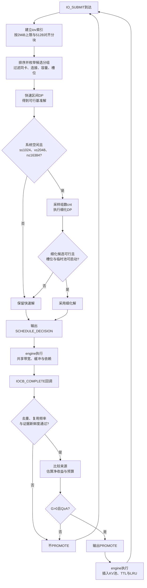

# 算法设计

本方案在线完成两类决策：**请求到达时**为未命中IOCB分块、分组并选择路径；**IOCB完整完成后**决定是否PROMOTE及提升来源。只使用公开费率、性能桶、回调状态和已见请求，策略内部不运行模拟器、不读取未来Trace。

优化目标为官方成本：

```text
J = c_t × T + C_CPU + C_NPU
```

`c_t`为每微秒折算成本（公开配置为1），`T`为Trace历时，后两项为累计CPU、NPU调用费。局部估价只用于选择方案，最终`J`由官方engine执行后复算。

| 时点 | 回调 | 本方案输出 |
| --- | --- | --- |
| 一批未命中请求到达 | `on_submit` | `SCHEDULE_DECISION`：分组、路径、传输项及依赖 |
| 一个IOCB前台完成 | `on_iocb_complete` | 一条PROMOTE，或返回空表示不提升 |
| 传输执行、缓存插入与驱逐 | 框架 | 只读运行时状态，继续下一次决策 |



静态版本见[总体流程](images/算法总体流程.svg)；完整算例见[双卡读取逐步示例](双卡读取逐步示例.md)。

## 一、前台：分块、分组与选路

### 1.1 记号

| 符号 | 含义 |
| --- | --- |
| s、v、b | 本次提交的IOCB数、iov总数、分块数 |
| n | 参与规划的片段数 |
| P、L | 一组的512B对齐物理SSD长度、有效字节数 |
| W | 向前枚举窗口，固定128 |
| q_s、q_c | SSD阶段、复制阶段的并发估计 |
| m | 临时池拥挤惩罚 |

### 1.2 分块

先为每个IOCB建立累计iov终点索引，把“IOCB内偏移”映射到“iov编号＋iov内偏移”。随后从偏移`o=0`逐块切分：

1. 取`l=min(2MiB, length-o)`。
2. 若当前块满足DIRECT对齐，保留`l`。
3. 否则令`M=max(hbm_capacity, ddr_capacity)`，先缩至`l=min(l, M-(ssd_offset+o) mod 512)`，为起点扩读留空间；若仍有后续数据，再把块尾退到512B边界，避免相邻块重复读取边界扇区。
4. 记录片段`{iocb, o, l, aligned, whole}`，令`o←o+l`，直至覆盖完整IOCB。

DIRECT要求SSD起点、长度以及每个相交HBM片段的起点、长度均为512B整数倍；非对齐块走AGGREGATE或FALLBACK。物理读取范围为`[align_down(begin), align_up(end))`，扩读字节只存在于SSD阶段，复制阶段只搬有效字节。

2MiB、`W=128`等是控制搜索规模的人为参数，不是赛题限制。

### 1.3 候选分组

片段按`(device_id, SSD起点, iocb_id, 偏移)`排序，从每个位置向后最多扩展`W`个片段。只有下列条件全部满足才继续扩展：

| 条件 | 规则 |
| --- | --- |
| 同卡 | 组内`device_id`一致 |
| SSD可连接 | 下一片段向下对齐512B后不晚于当前最远终点向上对齐512B |
| 块大小 | 扩展新片段后，合并的物理SSD范围`P`不超过2MiB |
| 拆分隔离 | 被拆分的IOCB不与其他IOCB共享操作，避免请求槽位交叉等待 |
| 槽位 | DIRECT、AGGREGATE的不同IOCB数不超过`iocb_capacity`；FALLBACK不占NDS槽位 |

对每组计算`P`（SSD读取量）和`L`（有效复制量），再检查路径合法性：

| 路径 | 传输阶段 | 额外条件 |
| --- | --- | --- |
| DIRECT | `DIRECT` | 所有源、目标交集均512B对齐，组内片段连续 |
| AGGREGATE | `SSD_TO_HBM_BUFFER`→`D2D` | `P≤hbm_capacity`，D2D并发上限大于0 |
| FALLBACK | `SSD_TO_DDR`→`H2D` | `P≤ddr_capacity`，H2D并发上限大于0 |

三条路径都不可用时不生成缺少覆盖的计划，直接报不可行。

### 1.4 估价

每个合法“分组＋路径”候选的估计成本为：

```text
E = c_t × (t_SSD + t_copy) × m + C_CPU + C_NPU
```

| 项 | 计算 |
| --- | --- |
| `t_SSD` | 按`P`与DIRECT或SSD→DDR性能桶，使用`q_s`换算微秒 |
| `t_copy` | AGGREGATE按`L`与D2D表；FALLBACK按`L`与H2D表，使用`q_c` |
| `m` | DIRECT为1；AGGREGATE为`1+0.5×hbm_used/hbm_capacity`；FALLBACK为`1+0.5×ddr_used/ddr_capacity` |
| `C_CPU`、`C_NPU` | 按官方固定费、命令费和调用费累加，不乘`m` |

公开参数下，一组“一读、至多一复制”的调用费为：DIRECT 2、AGGREGATE 5、FALLBACK 12。

并发估计只用于估价，不是执行期真实并发：

- 复制并发`q_c`＝该卡在飞复制项＋该卡本批IOCB数；聚合、回退分别受`hbm_copy_concurrency`、`h2d_copy_concurrency`约束。
- SSD并发`q_s`＝既有在飞SSD项＋本批片段数`n`。槽位在候选阶段按不同IOCB数过滤，估价不再模拟槽位排队。

### 1.5 两级动态规划

**快速区间DP。** 先求一个可行解：

```text
dp[0]=0
dp[j]=min(dp[i]+E([i,j),path))
```

`dp`按片段序号推进，边对应1.3节候选；复杂度`O(bW)`，并作为后续搜索的基准解。

**细化DP。** 仅当系统空闲（无在飞传输、排队IOCB、在飞PROMOTE和前台IOCB）、`s≤1024`、`v≤2048`、`n≤16384`时启用。固定“恰好cnt组”，每组恰有一条SSD传输：

```text
D[0][0]=0，其余为+∞
D[h][j]=min(D[h-1][i]+E([i,j),path,cnt))
候选成本=D[cnt][n]
```

细化DP使用`q_s=active_ssd+cnt`；复制并发按`cnt`相对快速解的组数比例缩放。`cnt`从以下来源去重采样：快速解的组数、最少可行组数、`n`；`n≤24`时尝试全部值，否则取性能桶并发边界、`1/2/4/8…`几何序列、总字节数除以8KiB至8MiB各尺寸的上下取整。最后在最佳`cnt`附近尝试`±1、±2、±ceil(5%×cnt)`。

候选必须同时满足：全部NDS所有者可同时获得槽位、HBM/DDR临时占用不超过当前可用容量。在通过检查的`cnt`中取最小`D[cnt][n]`；没有可行候选时保留快速解。

状态数、合法边数、组数采样数和每次`on_submit`的转移次数均有上限；每个`cnt`会重算一次候选边权重。超限时跳过该`cnt`并保留已有解，预算与复杂度见[复杂度分析](复杂度分析.md)。

### 1.6 输出与记账

每个最终分组输出一个operation：

- DIRECT：一条`DIRECT`传输。
- AGGREGATE：一条`SSD_TO_HBM_BUFFER`＋一条`D2D`，后者`depends_on`前者。
- FALLBACK：一条`SSD_TO_DDR`＋一条`H2D`，后者`depends_on`前者。

`ranges`标注每个IOCB的覆盖区间，`vectors`标注复制阶段命中的iov片段；非DIRECT另带`buffer_bytes`。前台`priority=100`，`not_before_us`为当前时刻，`next_wakeup_us=null`。

只为最终选中计划记账：组内SSD工作、复制工作和调用费按各IOCB有效字节占比分摊，供后台估算“命中可替代多少成本”。

## 二、后台：PROMOTE

PROMOTE是可选缓存投入，不阻塞源IOCB完成。依次通过四道判断：

### 2.1 去重与时效

缓存键为`(device_id, ssd_offset, length)`。

| 判断 | 不通过条件 |
| --- | --- |
| 真实未命中 | 由缓存命中完成的回调不提升 |
| 重复投入 | 同键正在提升，或已准入且无新的未命中证据 |
| 对象大小 | `length > kvcache_pool_capacity` |
| 复用频率 | 可见未命中少于2次，或平滑间隔`gap≤0`、`gap≥TTL`、`TTL≤0` |
| 证据新鲜度 | `age≥TTL`，或`age>max(1, gap+2×jitter)` |
| 字节距离 | 自上次出现以来推进字节数超过KV池容量 |

`gap`按`0.5×旧值+0.5×新间隔`平滑；`jitter`为平滑绝对偏差。TTL边界严格排除，实际缓存有效期仍从PROMOTE完成插入时起算。

### 2.2 选择来源

对PROMOTE_SSD与PROMOTE_HBM分别估计就绪成本：

```text
SSD排序值 = c_t × f_S × q_S × (1 + n_S/q_S) + CPU_PROMOTE_PER_CMD_COST
HBM排序值 = c_t × f_H × q_H × (1 + n_H/D2H_CC)
            + CPU_D2H_CALL_COST + NPU_D2H_CALL_COST
```

`f_S`为对齐物理范围按SSD→DDR表的服务时间，`f_H`为完整有效长度按D2H表的服务时间；`q_S`为全局活动SSD项＋1，`q_H`为源卡活动D2H项＋1且受`D2H_CC=d2h_copy_concurrency`约束；`n_S`、`n_H`为在途提升数。SSD严格更小则选SSD，否则选HBM；D2H并发上限为0时只能选SSD。

选定后的新增投入`P`：

```text
选SSD：P = CPU_PROMOTE_FIXED_COST + c_t×f_S + CPU_PROMOTE_PER_CMD_COST
选HBM：P = CPU_PROMOTE_FIXED_COST + c_t×f_H×a
          + CPU_D2H_CALL_COST + NPU_D2H_CALL_COST
```

`a`为本批源卡有效字节占比，仅作按卡并行范围的近似权重。

### 2.3 净收益

```text
G = w × c_t × [R + a×(D-H)] + C - C_hit
C_hit = CPU_H2D_CALL_COST + NPU_H2D_CALL_COST = 2
```

`R、D、C`为前台记账分得的SSD工作、复制工作和调用费；`H`为命中后H2D工作量；`w`为时间权重：若已知最近提交间隔`g`，且`max(本批预计执行时长, 本IOCB等待＋执行时长)<g`，取0，否则取1。`w=0`只折扣时间收益，不抹掉调用费节省。

### 2.4 预算与容量

预算衡量已观察读取的历史支出：

```text
Q ← Q + k × max(0, c_t×(R+a×D) + C)
门槛 A = P × (1 + max(0, U+F+s-K)/K)
准入条件：G>0 且 Q≥A
```

`k`为尚未记账的到达时刻数，`U`为框架报告池占用，`F`为本策略在途提升字节，`s`为待提升对象大小，`K`为KV池容量。通过后清零预算，输出一条PROMOTE：`priority=10`、`not_before_us=当前时刻`。

提升完成后缓存项才生效；TTL从插入时起算，命中更新LRU但不续TTL。命中仍走框架H2D并计费。满池时按替换压力提高门槛，但不永久禁止新热点进入。

## 三、参数、边界与代码索引

| 参数 | 当前值 | 作用 |
| --- | ---: | --- |
| 前台块上限 | 2MiB | 控制单组规划粒度 |
| 枚举窗口`W` | 128 | 控制候选边数 |
| 细化DP采样数 | ≤81 | 控制组数搜索 |
| 单次DP状态上限 | 131072 | 控制内存 |
| 单次提交转移预算 | 2000000 | 控制CPU时间 |
| 历史记录上限 | 131072 | 控制长期状态 |

主要适用边界：

| 场景 | 处理 |
| --- | --- |
| 对齐、容量、槽位、覆盖 | 规划时过滤，官方validator复算 |
| 无复用、同刻重复、对象过大、TTL或新鲜度不足 | 不PROMOTE，前台读取照常完成 |
| 满池、热点迁移 | 提高预算门槛，允许替换；不精确估计LRU受害者价值 |
| 缓存命中、前后台竞争 | 命中占H2D并计费；PROMOTE_SSD共享SSD |
| 大输入或复杂状态 | 搜索有界，超预算保留快速解 |
| 到达突变、尾部提升 | 历史间隔与预算可能误判；尾部PROMOTE仍计入Trace时间 |

估价使用固定并发与静态性能桶，不跟踪队列和真实完成顺序，因此不保证全局最优。相对官方贪心，本方案联合决定分组与路径，并在完成时按复用证据、来源成本和预算决定是否提升。

| 文中步骤 | 代码位置 |
| --- | --- |
| iov索引、DIRECT检查 | `IovIndex`、`direct_ok` |
| 分块、候选、快速DP、细化DP | `on_submit`中的`build_decision` |
| 分组路径估价、组数采样 | `estimate`、`count_samples`、`solve_count` |
| 传输输出 | `operation` |
| 最终计划记账 | `plan_work` |
| 去重与在途提升同步 | `sync_promotions`、`pending_keys_`、`cache_admitted` |
| 来源、收益、预算、准入 | `on_iocb_complete` |

唯一策略源码为[player/solution.cpp](../01_调度算法源代码/player/solution.cpp)。输入输出协议见[输入输出格式说明](../03_输入输出说明/输入输出格式.md)，时间与空间复杂度见[复杂度分析](复杂度分析.md)，得分与逐例结果见[验证报告](../06_性能与资源报告/验证报告.md)。
