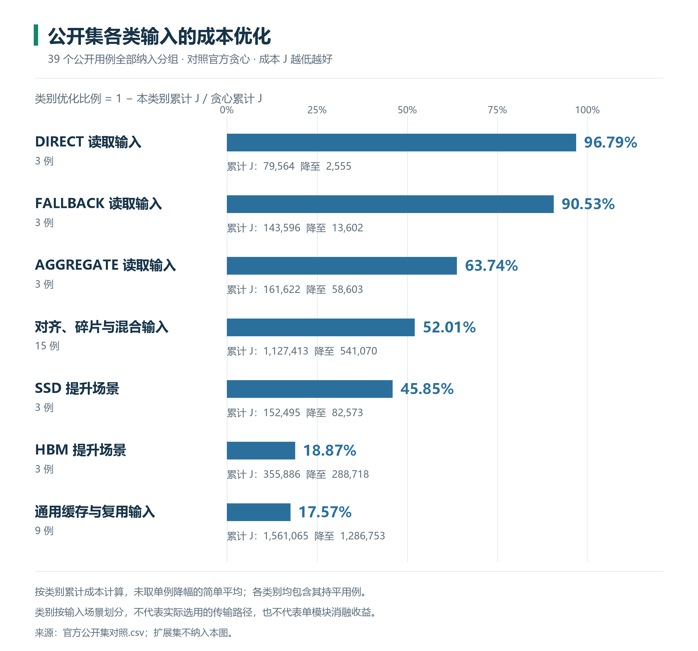
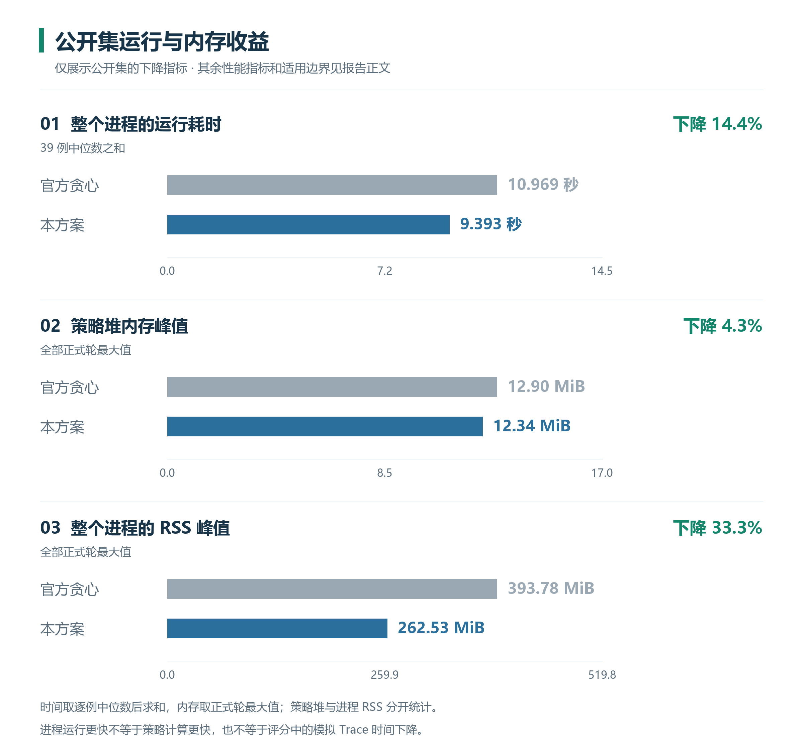

# 性能与资源开销报告

使用主线 `519ef500ad5f685a7e7e010c076960610018c20b` 的唯一策略，2026-10-30核验。源码、二进制、SDK及环境见[构建与验证摘要](构建与验证摘要.json)。所有结果使用原始官方engine与validator，评分参考成本保持不变。

## 1. 评分与成本收益



图1：先展示全部39例的总计，再按输入场景展示7个互不重复的分类，均包含持平用例。优化比例为 `1 − ΣJ_本方案 / ΣJ_官方贪心`，不是单例降幅的简单平均，也不是官方加权评分。类别描述输入场景，不代表实际选路或独立模块贡献。本报告的收益比较仅覆盖官方公开集，选手补充用例不纳入收益图表或汇总。

| 项目 | 结果 |
| --- | --- |
| 官方39条自动评分 | **88.4555/90**：可行性20、性能10、优化58.4555 |
| 官方贪心自动评分 | 67.1981/90；本方案高21.2574分 |
| 公开集相对官方贪心 | 35条更优、4条持平、0条更差 |
| 公开集累计总成本J（无权重） | **3,581,641 → 2,273,874，下降36.51%**，累计减少1,307,767 |

另10分为文档人工评分。公开集相对评分器的冻结参考成本有5条更差；**冻结参考成本与官方贪心是不同对照**。方案不保证每种负载都优于贪心。

逐例收益依据：[公开集成本](官方公开集对照.csv)。选手补充用例在本报告中仅用于说明合法性与输出一致性的验证覆盖，不据此推断补充输入或隐藏数据的收益。

### 代表输入的成本分解

| 输入 | 贪心J → 本方案J | 下降比例 | 可观察原因 |
| --- | --- | ---: | --- |
| read_direct_high | 64212 → 1483 | 97.69% | 物理读均为10MiB；CPU费40960 → 320，T从23252 → 1163µs；相邻小读聚合降低调用与执行成本 |
| high_mixed | 530416 → 174066 | 67.18% | 物理读3377451520 → 2718685184B；提升3566 → 0，双方命中均0；合并、选路及准入共同发挥作用 |
| promote_ssd_high | 110765 → 68491 | 38.17% | 命中18816 → 0，但CPU＋NPU费82944 → 40960，T从27821 → 27531µs；减少提升与命中搬运投入 |

这些是完整Trace的metrics分解，不能当作模块独立消融。逐例J见公开集对照CSV，重新运行`run.py score`可生成完整官方metrics。

### 适用边界

主要边界是静态并发/工作量估价无法精确表示启动、重叠与提前完成；2MiB块上限和128片段窗口可能错过更好的分组；历史复用预测与容量压力可能使新热点准入偏晚。详细条件见[算法设计](../04_算法设计与复杂度/算法设计.md)。

## 2. 合法性与验证覆盖

**655条输入各运行三次，共1965次运行与官方回放，全部合法且重复输出一致。** 每条输入的哈希、J、输出哈希和状态见[逐输入记录](逐输入验证.csv)。

| 输入来源 | 不重复计数 |
| --- | ---: |
| 官方公开集 | 39 |
| 选手补充用例 | 616 |
| 合计 | 655 |

选手补充用例包含已有生成器与补充数据中的去重输入，与官方公开集分开计数。所有合成输入按可见回归处理，不声称是官方隐藏集或未见分布；来源、冻结种子及获取命令见[复现手册](../05_自动化测试与复现/测试操作手册.md)。

173项专项检查通过：38功能、74边界/变形、19缓存准入、6评分门禁、8engine兼容、27规划、1策略依赖检查。另通过官方自测、四个教学示例与七场景演示，覆盖对齐、槽位、池容量、TTL、复制并发和性能桶边界。

## 3. 决策时间与内存



图2：仅展示公开集进程墙钟、策略堆峰值、进程RSS峰值三个下降指标。时间按每例正式轮的中位数求和，内存取全部正式轮最大值。其他指标与适用边界保留在下表和正文，进程耗时下降不等于策略自身计算加速。

环境：Linux、AMD EPYC 9575F、g++ 13.3.0、`-O2`，固定CPU 8。双方使用同一官方计量入口及外层回调计时器；每个公开输入各预热一次，交替执行三轮。没有清理共享缓存。编译耗时14秒量级，精确构建耗时见构建摘要，预热、每轮计时及独立验证耗时保存在资源开销CSV。

| 39条公开输入的指标 | 本方案 | 官方贪心 |
| --- | ---: | ---: |
| 策略回调时间：逐例中位数之和 | 1.153s | 0.831s |
| 进程墙钟：逐例中位数之和 | 9.393s | 10.969s |
| 策略堆峰值：所有正式轮最大值 | 12.34MiB | 12.90MiB |
| 进程RSS峰值：所有正式轮最大值 | 262.53MiB | 393.78MiB |

策略回调更慢，进程总时间更短：总时间还包含框架执行、输出规模与JSON读写，不能据此宣称策略计算更快。进程时间不包含编译、预热、独立validator；回调时间仅覆盖策略函数。正式策略没有计时器。共享主机噪声、输入规模与硬件会影响时间；这些秒数不等于J中的模拟微秒。

[资源开销CSV](资源开销.csv)保留逐轮测量与输入/输出哈希；运行环境见构建摘要。本报告仅使用`group=public`且`phase=measured`的记录，先按case和variant取时间中位数，再求和；内存取所有正式轮最大值。655条完整验证集的策略堆峰值为13.06MiB，与公开集测量分别统计。

## 4. 自动化验证与复现

在提交材料根目录执行：

```bash
python3 run.py quick       # 正确性、边界及专项检查
python3 run.py score       # 39条官方公开输入的评分与独立回放
python3 run.py runtime     # 策略时间、进程时间、策略堆及RSS测量
```

补充输入的分组验证与去重口径见[测试操作手册](../05_自动化测试与复现/测试操作手册.md)。图表由本报告引用的原始CSV汇总生成；计算口径见各图说明。

## 5. 前后台指标与缓存净收益

39条公开输入共198542个请求，双方使用相同输入、费用和engine。下表总量为逐Trace指标求和，平均项先汇总再相除，不是逐Trace平均值的简单平均；成本和的降幅不等于官方加权评分的增幅。逐例数据、输入与输出哈希见[前后台指标](前后台指标.csv)。

| 指标 | 官方贪心 | 本方案 | 含义 |
| --- | ---: | ---: | --- |
| 前台读操作数 | 177180 | 81768 | 当前每组一条SSD命令，减少53.85% |
| 前台物理SSD字节 | 41400624128 | 35332572160 | 排除PROMOTE_SSD，减少14.66% |
| 前台CPU＋NPU调用费 | 610928 | 202731 | 排除提升及框架命中复制，减少66.82% |
| 提升次数 | 8817 | 301 | 成功入池次数也分别为8817、301 |
| 提升搬运字节 | 3881057800 | 327938527 | 含SSD来源的对齐物理字节、HBM来源的有效字节 |
| 提升CPU＋NPU调用费 | 722994 | 24676 | 减少96.59%，不包含搬运时间费 |
| 真实命中请求数／请求命中率 | 40831／20.57% | 8403／4.23% | 分母均为198542个请求 |
| 缓存服务的有效字节 | 20830026916 | 8814336000 | 是逻辑命中字节，不等于少读的物理SSD字节 |
| 命中CPU＋NPU调用费 | 81662 | 16806 | KV→HBM仍需搬运和调用 |
| 后台总调用费：提升＋命中复制 | 804656 | 41482 | 减少94.84%，不含模拟搬运时间费 |
| 每次命中分摊的后台调用费 | 19.71 | 4.94 | 后台总调用费÷命中数，减少74.95% |
| 每次提升的平均命中数 | 4.63 | 27.92 | 总命中数÷总提升数，后者为前者6.03倍 |
| 关闭PROMOTE后的总J | 3686550 | 2344079 | 各自保留原前台策略，只关闭缓存准入 |
| 正常启用时的总J | 3581641 | 2273874 | 本方案相对贪心减少36.51% |
| 缓存净贡献：关闭J−启用J | **104909** | **70205** | 正值为收益，包含缓存与前台竞争、选路的联动 |

合并减少重复固定费，也可共享重叠范围的物理读取；联合选路改变调用结构。缓存改变了交给前台的未命中集合，因此前三项是完整方案对照，不能独立归因给分组或路径。两套方案的DIRECT／AGGREGATE／FALLBACK操作数分别为105767／65366／6047和69417／12045／306。

本方案以更少提升投入获得正净贡献，但绝对命中量和缓存净贡献均低于贪心。更便宜的前台读取也降低了缓存可替代的成本，不能据此声称缓存模块在所有指标上更强。启用相对关闭缓存，贪心6例正收益、17例负收益、16例持平；本方案6例正收益、2例负收益、31例持平。

每次命中分摊的调用费包含所有提升投入，含最终未带来命中的提升；它不是单次命中固有收费，后者双方均为2。这些比值反映完整方案的投入效率，不是同尺寸、同缓存内容的受控模块对照。`high_mixed`中双方均无命中，提升3566→0，提升调用费292412→0，直接展示了避免无回报投入的收益。

两条缓存消融负收益不表示输给贪心：`06_reuse_hot`的贪心／本方案开缓存／本方案关缓存J为41233／36356／36302；`mid_reuse`为185453／88409／87179。本方案完整结果仍分别优于贪心11.83%、52.33%。

总J节省1307767按官方收费恒等式分解为：前台调用费408197、提升调用费698318、命中调用费64856、模拟时间费136396。该分解解释费用变化，不是模块独立因果贡献。**engine的`promote_hit_rate`实际是成功入池率，不是请求命中率。**

复现：

```bash
python3 05_自动化测试与复现/frontend_background.py --output 运行结果/前后台指标
```

脚本在临时目录构建两套策略的启用／关闭版本。关闭版本仅停止PROMOTE：本方案仍清理完成请求的Work和到达登记，前台代码不变；贪心使用SDK原有开关。39×2×2共156次运行均通过官方validator；此次每种确定性成本运行一次，未据此更新墙钟性能结论。78份正常启用的输出哈希与既有三轮记录完全一致。脚本还校验“前台SSD＋提升SSD＝官方物理读”及“前台＋提升＋命中调用费＝官方总调用费”。
